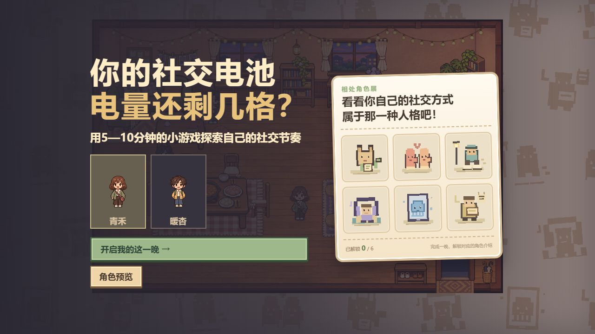
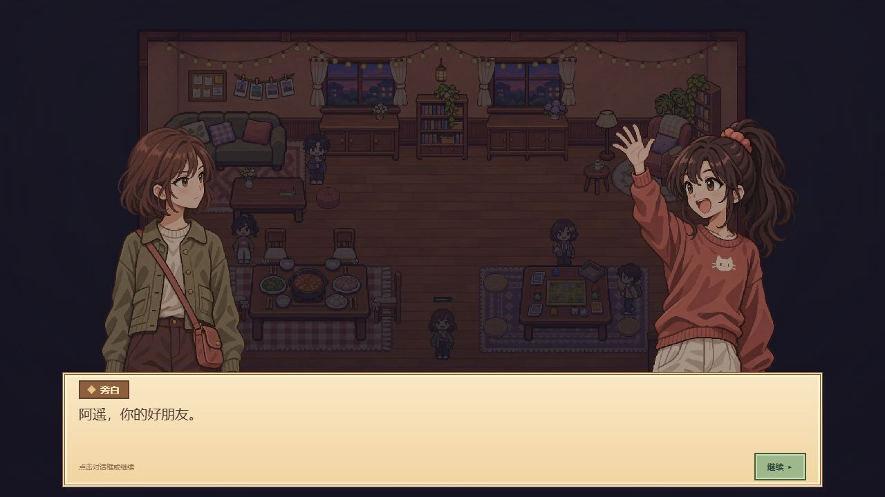

<div align="center">
  
  <h1>Social Battery</h1>
  <p><strong>A small campus adventure about connecting, saying goodbye, and recharging.</strong></p>
  <p><a href="README.md">简体中文</a> · <strong>English</strong></p>
  <p><a href="https://wsluyao.github.io/social-battery-game/">Play online</a> · <a href="https://github.com/wsLuYao/social-battery-game/actions/workflows/validate.yml">Validation</a></p>
</div>

> Spend 5–10 minutes navigating a campus gathering, choosing how to leave, and settling into a quiet dorm evening. Finish with a personal recharge guide and a printable receipt of the night's experiences.



## What you can do

The game is currently in Simplified Chinese. Choose Qinghe or Nuanxing, explore pixel-art scenes, and see how your actions change the evening's energy meter.

| Feature | Experience |
| --- | --- |
| Campus gathering | Conversations, activities, breaks, and interactive objects |
| Three departure routes | Head back early, take a walk, or stop for late-night noodles |
| Dorm activities | Computer, phone, music, snacks, quiet sitting, and time with a cat |
| Recharge guide | A two-sided card with a recap, a character interpretation, and practical suggestions |
| Recharge receipt | Animated printing, stamps, a QR code, and image export |
| Character gallery | Six characters unlocked through different choices |
| Local saves | Continue the same evening in the same browser |

Energy values and character outcomes come from game rules. They are prompts for reflection, not a validated personality test, psychological assessment, or diagnosis.

## Play

Open **[the online game](https://wsluyao.github.io/social-battery-game/)**. No account or installation is required.

- **Desktop:** Move with the arrow keys, WASD, or scene clicks. Follow the on-screen interaction prompts.
- **Mobile:** Landscape orientation is recommended; touch controls are available.
- **First visit:** Wait for the full-session resource preparation before selecting a character.
- **Return visit:** Continue from the title screen using the same browser and address.



## Run locally

This is a static release with no npm dependencies. With Python 3 installed:

```bash
git clone https://github.com/wsLuYao/social-battery-game.git
cd social-battery-game
python -m http.server 8000
```

Open [http://localhost:8000](http://localhost:8000). Serve the files over HTTP so the resource loader can read the bundled assets.

## How it works

- HTML, CSS, and vanilla JavaScript combine Canvas scenes with DOM interfaces.
- Images, audio, and runtime files are distributed with the repository; no external CDN is needed.
- Progress, settings, and gallery unlocks use browser LocalStorage. There is no account system or cloud synchronization.
- Sharing and image export are initiated by the player. The receipt's QR code links to the deployed game.

Clearing site data deletes local progress. Saves do not move automatically between devices or site addresses.

## Repository

```text
index.html / game.html   Game entry points
assets/runtime/         Bundled images, audio, and SVG assets
src/js/                 Startup, resource loader, and interaction guard
src/runtime/            Release runtime, styles, and resource manifest
docs/                   Cover, screenshots, and deployment notes
tools/validate.mjs      Static release validation
.github/workflows/      Validation on pushes and pull requests
.nojekyll               GitHub Pages static publishing marker
```

This repository is based on the November 16, 2026 v17 deployment bundle. The JavaScript runtime is a combined release file; the original project's offline-package build tools are not included.

## Validate and deploy

With Node.js installed:

```bash
node tools/validate.mjs
```

Validation checks asset presence and sizes, group dependencies, entry-point references, JavaScript syntax, and the receipt QR destination. GitHub Actions runs the same check on pushes and pull requests.

GitHub Pages publishes the root of the `main` branch. See the [deployment notes](docs/deployment.md) for configuration and migration details.

## Author

[王政锠 · Luyout Wang](https://github.com/wsLuYao). Report problems through [Issues](https://github.com/wsLuYao/social-battery-game/issues), including your browser, device, and reproduction steps.

Usage permissions for code and media assets are to be specified separately by the author.
