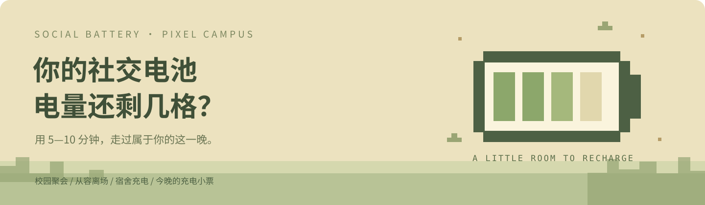
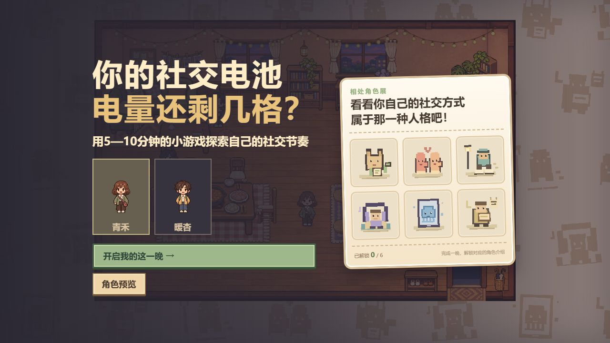
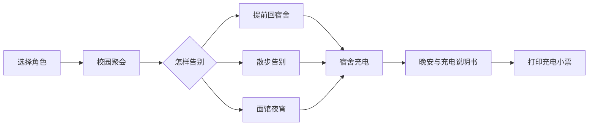
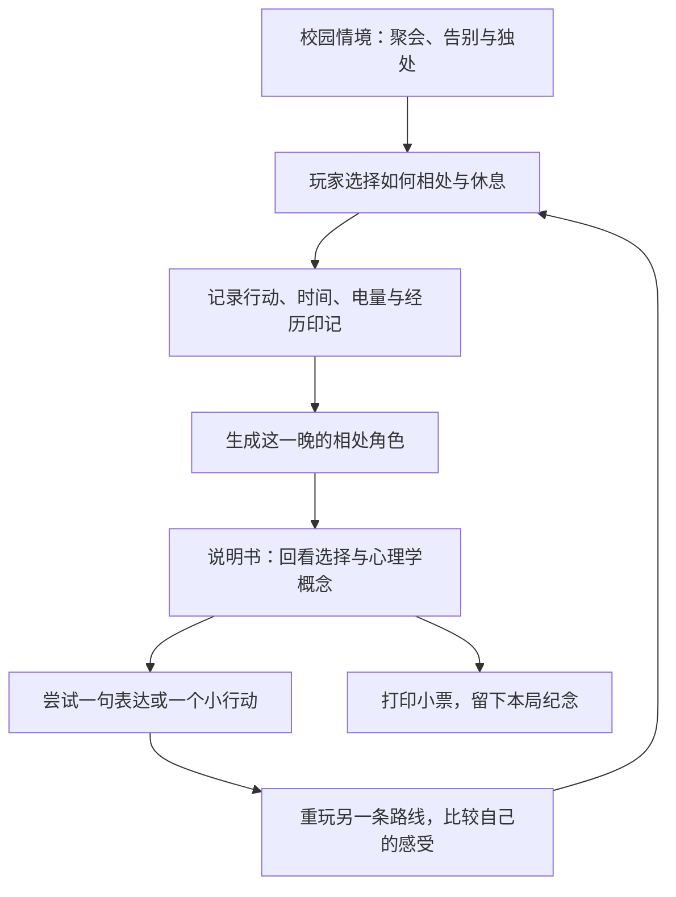
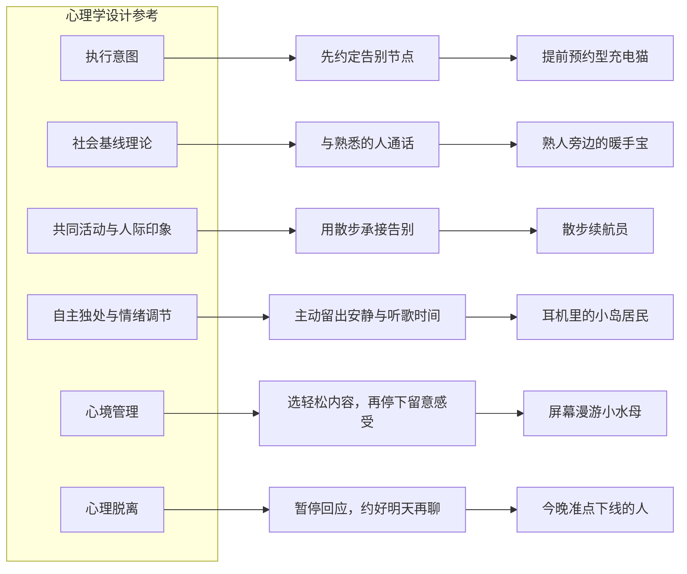
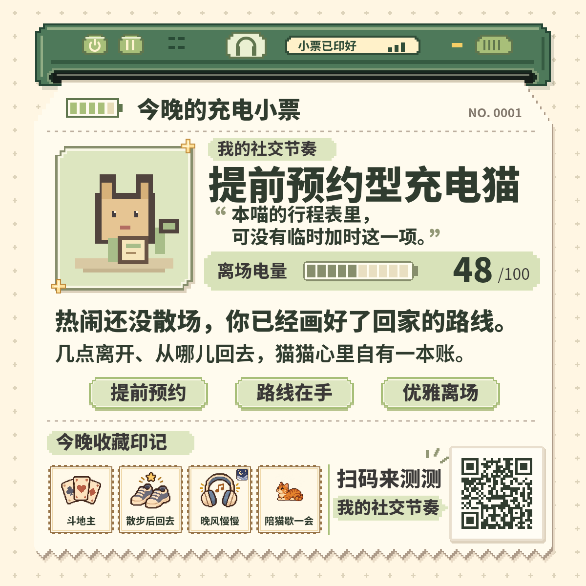
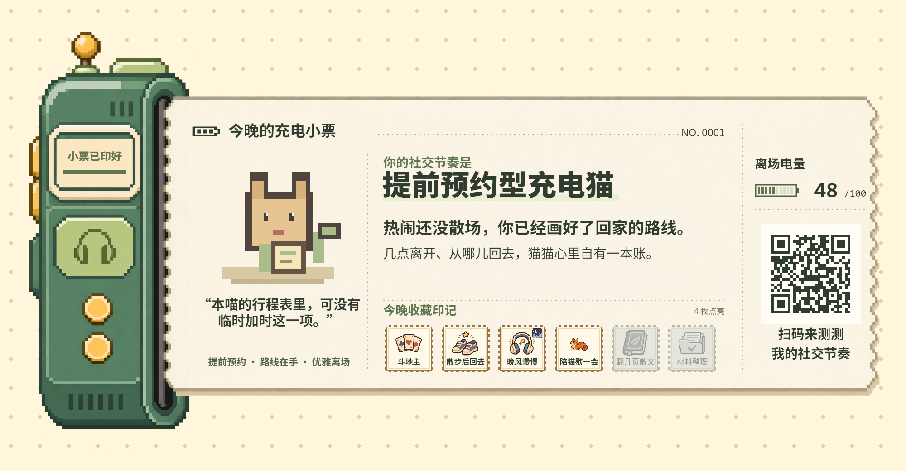
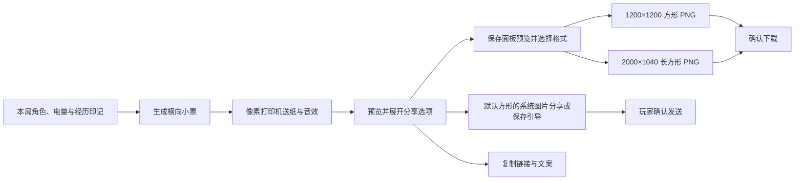

<div align="center">
  
  <br><br>
  <strong>简体中文</strong> · <a href="README.en.md">English</a>
  <br><br>
  <a href="https://wsluyao.github.io/social-battery-game/"></a>
  <a href="https://github.com/wsLuYao/social-battery-game/actions/workflows/validate.yml"></a>
  
  
  
  <p><strong>聚会可以尽兴，离场可以从容，独处也可以好好充电。</strong></p>
  <p><a href="https://wsluyao.github.io/social-battery-game/">立即游玩</a> · <a href="#它能做什么">玩法介绍</a> · <a href="docs/deployment.md">部署说明</a></p>
</div>

> 用 5—10 分钟，走过像素校园里的一晚：加入聚会、决定何时告别，回到宿舍做一点让自己恢复能量的小事，最后带走一张属于今晚的“充电小票”。

> **版权与使用**：本仓库公开展示，项目原创内容未授予开源或其他开放使用许可。未经相应权利人事先书面许可，禁止复制、分发、重新部署或商业使用。个人游玩与游戏内小票分享、GitHub 平台规则及第三方素材许可的具体范围见 [版权与使用声明](COPYRIGHT.md)。



**当前版本：[v22 · 2026-11-17](version.json)**

## 它能做什么

“你的社交电池，电量还剩几格？”是一款围绕大学生日常相处与休息节奏的网页互动游戏。玩家选择青禾或暖杏，在校园聚会、离场和宿舍生活中做出行动，观察这一晚的电量变化。

| 模块 | 当前体验 |
| --- | --- |
| 像素校园 | 选择角色，在场景中移动、靠近人物和物件互动 |
| 聚会选择 | 聊天、参与活动、休息，在不同情境中安排自己的投入 |
| 三种离场路线 | 提前回去、散步告别、面馆夜宵，体验各自的过渡剧情 |
| 宿舍充电 | 电脑、手机、音乐、零食、静坐与猫咪陪伴等互动 |
| 今晚的充电说明书 | 双面翻卡展示经历、角色解读和可尝试的相处建议 |
| 充电小票 | 横向出票演出、方形与长方形保存、当晚印记与二维码 |
| 角色图鉴 | 通过不同的游玩选择，逐步解锁六种相处角色 |
| 本地存档 | 自动保存进度，刷新后可以继续这一晚 |

电量与角色由游戏中的行动规则生成，用来帮助玩家回看自己的选择，**不构成人格测验、心理量表或诊断结论**。

## 立即体验

打开 **[在线游戏](https://wsluyao.github.io/social-battery-game/)** 即可游玩，无需注册或安装。

- **电脑**：使用方向键或 WASD 移动，也可以点击场景移动；靠近互动点后按页面提示操作。
- **手机**：建议横屏，使用触屏移动与互动；竖屏时可选择“进入横屏模式”。
- **首次进入**：载入资源时可以玩「接住小星光」，用方向键、屏幕按钮或拖动移动小盒子。资源就绪后进入封面，接星数量独立于主游戏存档。
- **再次进入**：在同一浏览器、同一网址下选择继续游玩。

## 这一晚怎么展开



六种相处角色分别是：**提前预约型充电猫、熟人旁边的暖手宝、散步续航员、耳机里的小岛居民、屏幕漫游小水母、今晚准点下线的人**。它们描述的是这一晚的游戏经历，玩家可以重玩，尝试不同的相处和恢复方式。

## 心理学怎样融入玩法

作品把“社交电池”作为可见的游戏隐喻：每次聊天、参与活动、告别和休息，都留下时间与电量记录，让玩家回看自己这一晚怎样投入、何时停下、选择什么方式恢复。游戏允许玩家尝试不同路线，再从经历回到具体的自我提问：“我现在还想继续吗？”“哪种陪伴让我舒服？”“我可以怎样说出休息的需要？”

设计把“选择、反馈、理解、尝试”连成一个可回看的循环：



以下流程表示概念在玩法中的落点，箭头表示设计关联：



六种角色将游戏经历连接到六个设计参考。下表说明的是游戏怎样使用这些概念；角色结果由本局选择生成，电量数值由游戏规则设定，不是研究中的测量值。

| 相处角色 | 心理学设计参考 | 在游戏中的表达 |
| --- | --- | --- |
| 提前预约型充电猫 | 执行意图 | 提前问清聚会时长，为告别约定具体节点，并提供可以直接说出口的句子 |
| 熟人旁边的暖手宝 | 社会基线理论 | 把熟悉同伴和宿舍通话设计为陪伴入口，让玩家探索怎样的关系与交流更舒适 |
| 散步续航员 | 共同活动与人际印象 | 用并肩散步承接散场后的相处，让轻量共同活动成为继续交流的方式 |
| 耳机里的小岛居民 | 自主独处与情绪调节 | 提供主动选择安静、听歌和暂停的空间，之后仍可重新加入交流 |
| 屏幕漫游小水母 | 心境管理 | 让玩家选择轻松内容，并在观看后停一下，留意当下感受再决定下一步 |
| 今晚准点下线的人 | 心理脱离 | 将工作恢复研究中的“暂时放下”类比到社交消息，为结束回应、约定明天再聊提供表达 |

充电说明书按“本局经历—概念解释—可尝试的小行动”组织，并提供研究来源与适用范围。散步、听歌、短视频和暂缓回复等安排属于场景化设计，不表示这些活动具有固定的恢复效果。完整来源入口保留在游戏说明书中；相关设计参考也包括 [Gollwitzer 与 Brandstätter（1997）](https://sparq.stanford.edu/sites/g/files/sbiybj19021/files/media/file/gollwitzer_brandstatter_1997_-_implementation_intentions_effective_goal_pursuit.pdf)、[Coan 与 Sbarra（2015）](https://pubmed.ncbi.nlm.nih.gov/25825706/)、[Cheng 等（2020）](https://journals.plos.org/plosone/article?id=10.1371/journal.pone.0227880)、[Nguyen 等（2018）](https://journals.sagepub.com/doi/10.1177/0146167217733073)、[Bryant 与 Zillmann（1984）](https://doi.org/10.1080/08838158409386511)和 [Sonnentag 与 Bayer（2005）](https://pubmed.ncbi.nlm.nih.gov/16248688/)。

## 把这一晚打印成充电小票

完成一晚后，玩家可以在充电说明书中选择**打印我的“充电小票”**。像素打印机以送纸动画和柔和打印声，在预览中送出横向票据。点击保存后，可预览并选择方形或长方形小票，再确认下载。系统图片分享与长按保存默认采用方形 PNG。

- **对应本局的相处角色**：角色像素形象、专属配色、角色寄语和标签共同呈现这一晚的社交节奏。
- **回看当晚电量**：小票展示离场电量，充电说明书可回看今晚最低电量。
- **收藏经历印记**：小票根据当晚实际发生的事件点亮印记，区分这一晚的经历与长期累计的角色图鉴。
- **保存一致的画面**：横向出票预览保留打印机演出；保存面板提供 1200×1200 方形和 2000×1040 长方形两种 PNG。方形采用顶部窄条打印机与宽票面，长方形保留侧边打印机与横向出纸构图。系统图片分享与长按保存默认采用方形。
- **邀请朋友来体验**：票据附游戏二维码；分享入口提供微信、朋友圈、QQ、QQ 空间及链接等路径，并根据设备能力提供系统图片分享、保存图片或复制文案与链接。

以下两张图片均由 **v21 实际小票渲染器**使用同一组游戏示例记录生成。示例角色为“提前预约型充电猫”，展示相同的离场电量与当晚印记，便于比较两种构图。

**方形小票 · 1200×1200**

顶部窄条像素打印机连接宽票面，适合手机相册和方形图片分享。系统图片分享与长按保存默认使用此格式。



**长方形小票 · 2000×1040**

左侧完整像素打印机连接横向票据，保留出票演出的构图，适合横屏展示。保存面板可切换到此格式，预览后确认下载。



小票从本局数据到分享的过程：



手机系统和应用支持情况会影响分享方式；网页不会自动向联系人发送内容，最终发送由玩家确认。微信内可使用右上角菜单分享链接，或保存小票后从相册发送。分享链接不携带浏览器存档；玩家主动分享的小票会展示本局结果。

允许通过游戏提供的功能保存和分享自己生成的小票，用于个人非商业体验交流；独立素材提取、完整游戏分发、重新部署和商用仍需另行授权，具体见 [版权与使用声明](COPYRIGHT.md)。

## 界面预览


## 本地运行

这是可直接部署的静态发布版，没有需要安装的 npm 依赖。使用 Python 3 在仓库目录启动本地服务器：

```bash
git clone https://github.com/wsLuYao/social-battery-game.git
cd social-battery-game
python -m http.server 8000
```

然后打开 [http://localhost:8000](http://localhost:8000)。请通过 HTTP 访问，资源加载器需要读取本地图片、声音和运行脚本。

## 工作方式与数据

- **页面**：HTML、CSS 与原生 JavaScript，结合 Canvas 场景和页面交互层。
- **资源**：图片、音频和运行文件随仓库分发，由资源清单统一加载。大部分图片采用 WebP 压缩，音频采用 MP3 压缩，资源由清单统一加载。
- **存档**：进度、设置与图鉴保存在当前浏览器的 LocalStorage，没有账号或云端同步。
- **分享**：玩家主动保存图片、复制文案或选择分享入口；小票二维码指向在线游戏。

清理浏览器站点数据会删除本地进度；换设备或换网址不会自动带上原来的存档。

## 项目结构

```text
.
├── index.html                 # 默认游戏入口
├── game.html                  # 兼容入口
├── assets/runtime/            # 随包分发的图片、音频与 SVG
├── src/
│   ├── js/                    # 启动、资源加载与交互保护
│   └── runtime/               # 游戏运行包、样式与资源清单
├── docs/                      # 项目封面、截图与部署说明
├── tools/validate.mjs          # 发布文件完整性检查
├── .github/workflows/         # 提交时运行静态验证
├── version.json               # 当前发布版本
└── .nojekyll                  # GitHub Pages 静态发布标记
```

当前版本为 **v22 · 2026-11-17**，基于加载与分享优化的轻量部署包，保留其游戏流程与美术资源。运行脚本是发布时合并的文件；本仓库不包含原工程中生成离线包的构建工具。

## 验证与部署

使用 Node.js 运行资源与脚本检查：

```bash
node tools/validate.mjs
```

检查覆盖资源清单中的文件存在性与大小、分组依赖、HTML 入口引用、JavaScript 语法和分享二维码地址。GitHub Actions 会在提交及 Pull Request 时执行同一检查。

网站通过 GitHub Pages 从 `main` 分支根目录发布，后续上传更新会触发重新部署。配置与迁移方法见[部署说明](docs/deployment.md)。

## 关于作品

作者：王政锠（Zhengchang Wang）、何品洁（Pinjie He），华中师范大学心理学院。项目维护：[wsLuYao](https://github.com/wsLuYao)。欢迎通过 [Issues](https://github.com/wsLuYao/social-battery-game/issues) 反馈体验问题，并注明设备、浏览器和发生问题的步骤。

**项目原创内容保留所有权利，未授予开源或其他开放使用许可**。未经相应权利人事先书面许可，禁止复制、分发、重新部署或商业使用。第三方图标保留其自身许可，详见 [版权与使用声明](COPYRIGHT.md)和 [第三方素材声明](THIRD_PARTY_NOTICES.md)。

<div align="center">
  <sub>给相处留一点余裕，也给自己留一点电。</sub>
</div>
