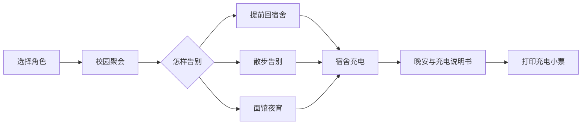
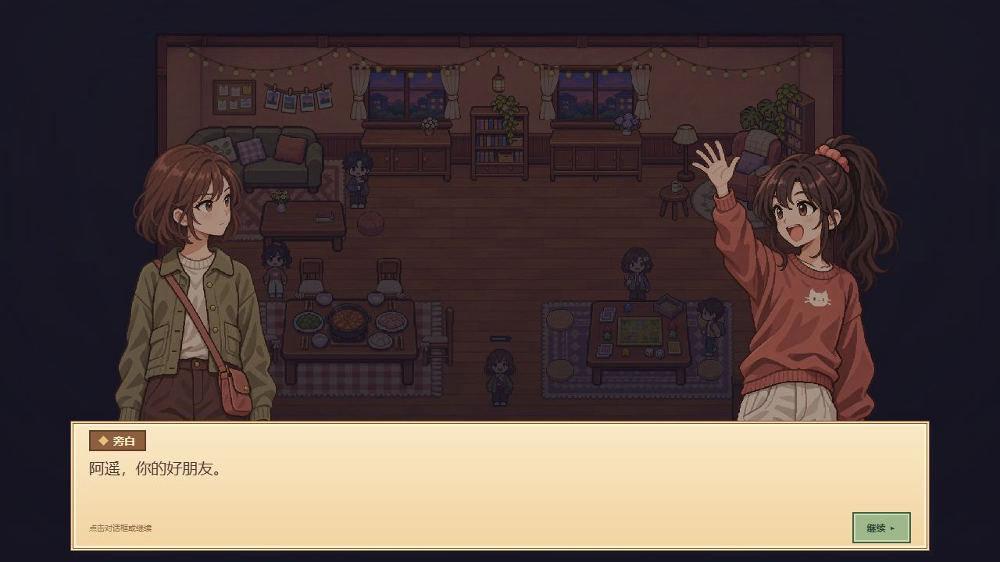

<div align="center">
  
  <br><br>
  <strong>简体中文</strong> · <a href="README.en.md">English</a>
  <br><br>
  <a href="https://wsluyao.github.io/social-battery-game/"></a>
  <a href="https://github.com/wsLuYao/social-battery-game/actions/workflows/validate.yml"></a>
  
  
  
  <p><strong>聚会可以尽兴，离场可以从容，独处也可以好好充电。</strong></p>
  <p><a href="https://wsluyao.github.io/social-battery-game/">立即游玩</a> · <a href="#它能做什么">玩法介绍</a> · <a href="docs/deployment.md">部署说明</a></p>
</div>

> 用 5—10 分钟，走过像素校园里的一晚：加入聚会、决定何时告别，回到宿舍做一点让自己恢复能量的小事，最后带走一张属于今晚的“充电小票”。


## 它能做什么

“你的社交电池，电量还剩几格？”是一款围绕大学生日常相处与休息节奏的网页互动游戏。玩家选择青禾或暖杏，在校园聚会、离场和宿舍生活中做出行动，观察这一晚的电量变化。

| 模块 | 当前体验 |
| --- | --- |
| 像素校园 | 选择角色，在场景中移动、靠近人物和物件互动 |
| 聚会选择 | 聊天、参与活动、休息，在不同情境中安排自己的投入 |
| 三种离场路线 | 提前回去、散步告别、面馆夜宵，体验各自的过渡剧情 |
| 宿舍充电 | 电脑、手机、音乐、零食、静坐与猫咪陪伴等互动 |
| 今晚的充电说明书 | 双面翻卡展示经历、角色解读和可尝试的相处建议 |
| 充电小票 | 热敏打印演出、横向票据、当晚印记、二维码与图片保存 |
| 角色图鉴 | 通过不同的游玩选择，逐步解锁六种相处角色 |
| 本地存档 | 自动保存进度，刷新后可以继续这一晚 |

电量与角色由游戏中的行动规则生成，用来帮助玩家回看自己的选择，**不构成人格测验、心理量表或诊断结论**。

## 立即体验

打开 **[在线游戏](https://wsluyao.github.io/social-battery-game/)** 即可游玩，无需注册或安装。

- **电脑**：使用方向键或 WASD 移动，也可以点击场景移动；靠近互动点后按页面提示操作。
- **手机**：建议横屏，使用触屏移动与互动；竖屏时可选择“进入横屏模式”。
- **首次进入**：页面会先准备整局资源。加载完成后选择角色开始，声音可通过界面按钮关闭。
- **再次进入**：在同一浏览器、同一网址下选择继续游玩。

## 这一晚怎么展开



六种相处角色分别是：**提前预约型充电猫、熟人旁边的暖手宝、散步续航员、耳机里的小岛居民、屏幕漫游小水母、今晚准点下线的人**。它们描述的是这一晚的游戏经历，玩家可以重玩，尝试不同的相处和恢复方式。

## 界面预览



## 本地运行

这是可直接部署的静态发布版，没有需要安装的 npm 依赖。使用 Python 3 在仓库目录启动本地服务器：

```bash
git clone https://github.com/wsLuYao/social-battery-game.git
cd social-battery-game
python -m http.server 8000
```

然后打开 [http://localhost:8000](http://localhost:8000)。请通过 HTTP 访问，资源加载器需要读取本地图片、声音和运行脚本。

## 工作方式与数据

- **页面**：HTML、CSS 与原生 JavaScript，结合 Canvas 场景和页面交互层。
- **资源**：图片、音频和运行文件随仓库分发，由资源清单统一加载，无需外部 CDN。
- **存档**：进度、设置与图鉴保存在当前浏览器的 LocalStorage，没有账号或云端同步。
- **分享**：玩家主动保存图片、复制文案或选择分享入口；小票二维码指向在线游戏。

清理浏览器站点数据会删除本地进度；换设备或换网址不会自动带上原来的存档。

## 项目结构

```text
.
├── index.html                 # 默认游戏入口
├── game.html                  # 兼容入口
├── assets/runtime/            # 随包分发的图片、音频与 SVG
├── src/
│   ├── js/                    # 启动、资源加载与交互保护
│   └── runtime/               # 游戏运行包、样式与资源清单
├── docs/                      # 项目封面、截图与部署说明
├── tools/validate.mjs          # 发布文件完整性检查
├── .github/workflows/         # 提交时运行静态验证
└── .nojekyll                  # GitHub Pages 静态发布标记
```

当前仓库以 **2026-11-16 v17 网站部署包**为基础，保留其游戏流程与美术资源。运行脚本是发布时合并的文件；本仓库不包含原工程中生成离线包的构建工具。

## 验证与部署

使用 Node.js 运行资源与脚本检查：

```bash
node tools/validate.mjs
```

检查覆盖资源清单中的文件存在性与大小、分组依赖、HTML 入口引用、JavaScript 语法和分享二维码地址。GitHub Actions 会在提交及 Pull Request 时执行同一检查。

网站通过 GitHub Pages 从 `main` 分支根目录发布，后续上传更新会触发重新部署。配置与迁移方法见[部署说明](docs/deployment.md)。

## 关于作品

作者：[王政锠 · Luyout Wang](https://github.com/wsLuYao)。欢迎通过 [Issues](https://github.com/wsLuYao/social-battery-game/issues) 反馈体验问题，并注明设备、浏览器和发生问题的步骤。

代码及图片、音频等素材的使用授权由作者另行说明。

<div align="center">
  <sub>给相处留一点余裕，也给自己留一点电。</sub>
</div>
